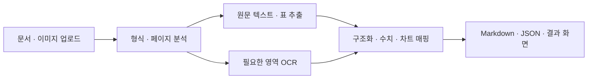

# 문서 전처리·OCR 파이프라인

HWPX·DOCX·PDF·이미지를 Markdown과 구조화 JSON으로 바꾸는 프로젝트입니다. 문서의 원문 구조를 보존하면서 OCR이 필요한 영역만 처리하는 웹앱과, 재사용 가능한 `ocrpipe` 라이브러리를 함께 제공합니다.

## 해결하려던 문제

문서 전체를 OCR하면 원래 읽을 수 있던 텍스트까지 다시 인식하면서 오류와 처리 비용이 늘어납니다. 반대로 텍스트만 추출하면 이미지·차트와 스캔 페이지의 정보를 놓칩니다. 문서 유형과 페이지 상태를 먼저 판단하고 원문 추출과 OCR을 나눠 처리하도록 구성했습니다.

## 처리 흐름



## 설계와 문제 해결

- **원문 보존:** 텍스트 PDF·DOCX·HWPX는 원문 구조를 추출하고 포함 이미지를 별도로 처리합니다.
- **부분 OCR:** 스캔 페이지는 전체 OCR, 텍스트와 이미지가 섞인 페이지는 필요한 영역만 OCR합니다.
- **실패 격리:** OCR 워커가 비정상 종료되면 재기동·재시도하고 해당 페이지의 실패와 서버의 상태를 구분합니다.
- **결과 활용:** 텍스트 외에 표·이미지·차트 설명과 단위가 포함된 수치를 구조화합니다.
- **재사용:** 별도 `ocrpipe` 라이브러리에 추출·OCR·후처리와 CER 평가 도구를 구성했습니다. 웹앱과 라이브러리는 각각의 구현이며 자동으로 통합된 상태는 아닙니다.

## 구성과 기술

| 구성 | 역할 |
| --- | --- |
| `app/` | FastAPI 업로드·처리 작업·결과 조회, HTML/JavaScript 화면 |
| `app/document_parsers.py` | PyMuPDF·python-docx·HWPX XML 기반 원문 추출 |
| `app/paddle_worker.py` | PaddleOCR-VL-1.6 추론 프로세스 |
| `library/ocrpipe/` | 재사용 라이브러리·CLI·CER 평가 도구 |
| `tests/` | 합성 문서와 모의 OCR 기반 처리 흐름 검사 |

## 검증과 한계

기존 테스트 13개로 혼합 PDF, DOCX/HWPX, 수치·차트 매핑과 워커 복구를 확인했습니다. 실제 OCR 정확도와 속도는 이 테스트에 포함되지 않습니다. 라이브러리의 CER 도구는 정답 텍스트와 비교하는 별도 평가에 사용하며, 모델 신뢰도를 정답률로 해석하지 않습니다.

## 실행

```bash
git clone https://github.com/choisung-ho/document-ocr-pipeline.git
cd document-ocr-pipeline
python3 -m venv .venv
source .venv/bin/activate
pip install -r requirements.txt
pip install -r requirements-ocr.txt
uvicorn app.main:app --reload --host 127.0.0.1 --port 8000
```

브라우저에서 `http://127.0.0.1:8000`을 엽니다. 실제 OCR 없이 처리 흐름을 확인하려면 `OCR_MOCK=1`로 실행합니다. NVIDIA GPU에서는 CUDA 환경에 맞는 런타임을 준비해야 합니다.

- [처리 옵션·결과 형식·CPU/GPU 안내](docs/USAGE.md)
- [ocrpipe 설치·API·평가 도구](library/README.md)
- [검증 기록](docs/PUBLIC_VALIDATION.md)

원본 업무 문서, 추출 이미지와 실제 OCR 결과는 저장소에 포함하지 않습니다.
